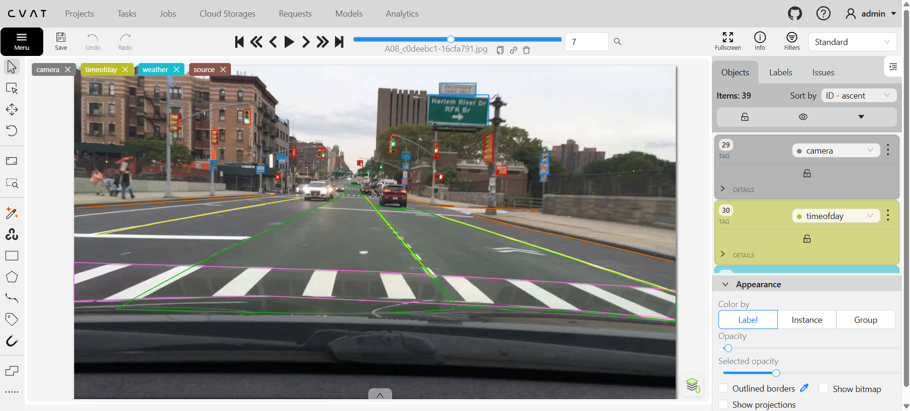
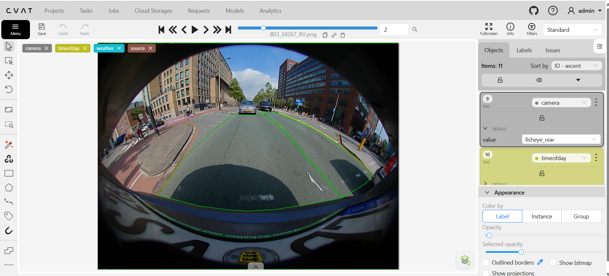
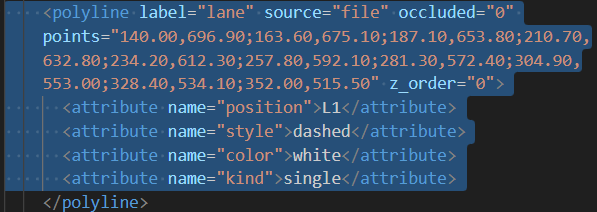

# Báo cáo cá nhân — Ngày 11
Họ tên: Phạm Võ Quang Hưng              Mã học viên: 2A202603259  
Phiên bản CVAT (Help → About): v2.81.0 (image `cvat/server:v2.81.0`, chạy local qua Docker)  
Guideline: Road v1.0    Lần nộp (`revision` trong manifest): 1  
Thời điểm export (ngày giờ trên CVAT): 21/11/2026 11:09 (giờ VN; trong XML ghi 04:09 UTC)    Số lần nộp lại sau Rework: 0  
Link Google Drive (2 file zip, chế độ công khai): https://drive.google.com/drive/folders/1_BugJH6QDnSGsz7EgHxzmQF5k_HjI-iE?usp=sharing  

## 1. Kiểm project
| Mục | Đúng như guideline Road v1.0? | Ghi chú |
| --- | --- | --- |
| 6 label, đúng kiểu | Đúng | lane, road_curb (polyline); crosswalk, drivable (polygon); traffic_light, traffic_sign (rectangle), theo phần meta của file export |
| Thuộc tính và giá trị | Đúng | Dán từ `configs/road_v1_labels.json`; lint không báo label lạ hay giá trị sai (QC1-12) |
| 4 tag ảnh | Đúng | camera, timeofday, weather, source là label kiểu Tag, mỗi tag có thuộc tính select `value`; cả 28 ảnh có đủ 4 tag |

Cách kết thúc polyline trên bản CVAT này: bấm phím **N** sau điểm cuối cùng.  
Cách đặt tag ảnh trên bản CVAT này: dùng công cụ **Setup tag** ở thanh bên trái, chọn label (ví dụ `camera`), rồi chọn giá trị trong ô `value` ở mục Details của bảng Objects.  

## 2. Số lượng đã gán
Front làm trong 1 task (A01–A16), fisheye trong 1 task (B01–B12). Bảng dưới tách ảnh chính và ảnh thêm theo mã ảnh.

| Task | Ảnh | lane | road_curb | crosswalk | drivable | traffic_light | traffic_sign |
| --- | ---: | ---: | ---: | ---: | ---: | ---: | ---: |
| front | 12 | 30 | 18 | 6 | 20 | 35 | 46 |
| front-extra (đã làm 4 / 4) | 4 | 9 | 4 | 6 | 9 | 11 | 16 |
| fisheye | 8 | 6 | 9 | 11 | 7 | 8 | 3 |
| fisheye-extra (đã làm 4 / 4) | 4 | 0 | 2 | 5 | 4 | 1 | 0 |

## 3. Bảng ca khó
| Ảnh | Nhãn | Phân vân giữa | Đã chọn | Lý do |
| --- | --- | --- | --- | --- |
| A05 | lane L1, R1 | vẽ L1/R1 hay không vẽ | không vẽ | Không thấy vạch sơn hai bên làn đang đi (QC1-02, chờ coach xác nhận miễn) |
| A06 | lane R1 | vẽ R1 hay không vẽ | không vẽ | Không thấy vạch sơn bên phải làn đang đi (QC1-02); lead đã xác nhận không thấy vạch R1 qua phiếu QC 1 |
| A09 | lane R1 | vẽ R1 hay không vẽ | không vẽ | Bên phải là mép đường, không có vạch sơn (QC1-02, chờ coach xác nhận miễn) |
| A14 | lane R1 | vẽ R1 hay không vẽ | không vẽ | Không thấy vạch sơn bên phải làn đang đi (QC1-02, chờ coach xác nhận miễn) |

## 4. Phiếu QC 1 nhận được
Bạn kiểm lô của tôi: TranThanhHung (2A202603247)  Quyết định nhận được: Release (0 lỗi nặng; lỗi chính 2 / 64 = 3,13 %; 3 lỗi nhẹ)  
| Mã lỗi | Số lỗi | Đồng ý? | Đã sửa? |
| --- | ---: | --- | --- |
| QC1-01 (nhẹ) | 3 | Đồng ý: A02 thiếu tag `timeofday`, `weather`, `source` | Đã sửa: A02 đủ 4 tag trong bản export |
| QC1-07 (chính) | 1 | Đồng ý: A01 polygon drivable bên phải là làn cùng chiều bên cạnh, lead xác nhận là `alternative` | Chưa sửa: vẫn đang là `direct` |
| QC1-07 (chính) | 1 | Đồng ý: A03 vùng drivable `direct` dừng ở y=690, lead xác nhận cần gán tới sát thân xe | Chưa sửa |
| QC1-02 (nặng, nghi vấn) | 0 | Đồng ý không tính lỗi: lead xác nhận A06 không thấy vạch R1 | Không cần sửa |

## 5. Kiểm file export
| File | Mở lại được? | Số shape ảnh 1 (job / file) | Số shape ảnh 2 (job / file) | Tag camera có trong XML? |
| --- | --- | --- | --- | --- |
| PhamVoQuangHung-front.zip | Có (`road_check lint` đọc được 16 ảnh, không kèm ảnh) | A01: 11 / 11 | A02: 7 / 7 | Có |
| PhamVoQuangHung-fisheye.zip | Có (`road_check lint` đọc được 12 ảnh, không kèm ảnh) | B01: 6 / 6 | B02: 8 / 8 | Có |

## 6. Ảnh chụp màn hình
1. Tab Labels của project `d11-road-phamvoquanghung`: đủ 6 label vẽ và 4 label tag.

   

2. Một ảnh camera trước đã gán đủ (làn, vùng lái, đèn/biển): A08, có lane, road_curb, drivable, crosswalk, 9 đèn, 8 biển và 4 tag.

   

3. Một ảnh fisheye đã gán, phóng to đoạn polyline cong: B03 (camera `fisheye_rear`), lane và road_curb đi theo cung cong của ảnh.

   

4. Một đoạn XML có `<polyline label="lane">`: vạch L1 của A01 trong `annotations.xml` của `PhamVoQuangHung-front.zip`.

   

## 7. Tự đánh giá
Lỗi bạn mắc nhiều nhất hôm nay (theo mã QC1-xx), và cách tránh ở Ngày 20: QC1-01 (tag ảnh). Ở lần export đầu, 4 ảnh fisheye thêm B09–B12 bị gán camera = `front`, A13 và A14 chưa có tag nào, A02 thiếu `timeofday`, `weather`, `source`. Lỗi thứ hai là QC1-03 (position): A01 và A03 có vạch bên phải xe bị gán `L1`, B06 (camera hông trái) có vạch gán `R1` thay vì `other`. Cách tránh: đặt 4 tag trước tiên ở mỗi ảnh như guideline mục 2, đọc đuôi tên file (`_FV`, `_RV`, `_MVL`, `_MVR`) để chọn camera; với lane, xác định vạch nằm bên trái hay bên phải tâm xe trước khi chọn position; chạy `road_check lint` sau mỗi lô ảnh thay vì đợi tới cuối buổi.  
Nhãn của bạn đi vào model ở đâu? Chọn một lỗi đã sửa và nói nó làm model học sai thế nào: Lỗi A01, vạch đứt bên phải xe bị gán `L1` (đã sửa thành `R1`). Nhãn lane đi vào model phát hiện làn, và đầu ra của model này được hệ thống giữ làn (LKA) dùng để biết mép trái, mép phải của làn đang đi. Nếu vạch phải bị gán `L1`, model học rằng mép trái làn nằm bên phải xe, nên ảnh đó dạy model một làn sai vị trí. Khi chạy thật, LKA có thể tính tâm làn lệch và đánh lái về phía làn bên cạnh. Lỗi tag camera ở B09–B12 thì làm ảnh fisheye rơi vào nhóm dữ liệu camera trước, nên model camera trước học từ ảnh méo cong không đúng loại.  

## 8. (Tùy chọn, buffer) Từ polyline đến đích row-anchor
| y | 720 | 680 | 640 | 600 | 560 |
| --- | ---: | ---: | ---: | ---: | ---: |
| x của chúng tôi |  |  |  |  |  |
| x của bạn kia |  |  |  |  |  |

Trả lời 3 câu:

1. Năm số x đó chính là đích mà một model row-anchor học cho vạch này. Nếu bạn dừng polyline sớm 40 px, hàng nào đổi thành "không có làn"?
2. So với bạn được kiểm (cùng ảnh): ở hàng 720 và hàng 560, hai bạn lệch nhau bao nhiêu pixel? Lệch ở hàng nào ảnh hưởng LKA nhiều hơn (slide 25)?
3. Nếu polyline vẽ từ xa về gần (ngược quy tắc 2), cách tính trên có đổi không? Script nào sẽ gặp khó?
